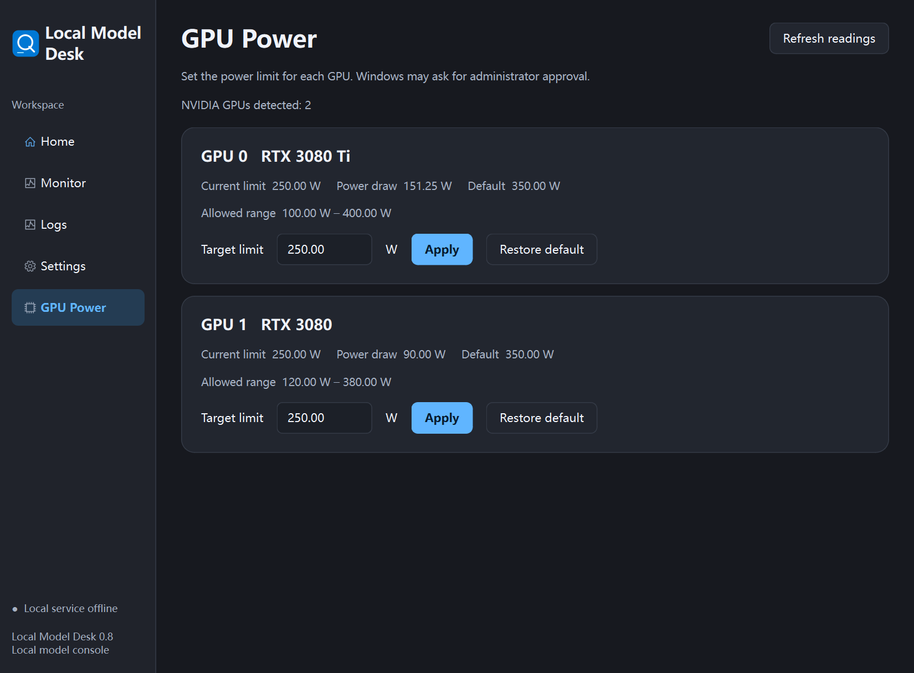

# Local Model Desk

Local Model Desk is a Windows desktop app for managing a local Strata model service and OpenCode. It provides a bilingual interface, an embedded Strata monitor, and per-GPU NVIDIA power controls.

Local Model Desk 是用于管理本地 Strata 模型服务和 OpenCode 的 Windows 桌面应用。它提供中英文界面、内嵌 Strata 监控和 NVIDIA 显卡独立功耗设置。



## Features / 功能

- Switch between the supported dual-GPU Qwen IQ2_XS and IQ3_XXS profiles, select a 32K–256K context, and check download requirements.
  切换受支持的双卡 Qwen IQ2_XS 和 IQ3_XXS 预设，选择 32K–256K 上下文，预检下载需求。
- Start or unload the model and sync the verified running model and context to OpenCode.
  启动或卸载模型，确认模型就绪后同步 OpenCode 的模型和上下文配置。
- Read and set per-GPU NVIDIA power limits, restore driver defaults, and confirm the result by reading the limit back from the driver.
  查看和设置每张 NVIDIA 显卡的功耗上限，支持恢复驱动默认值，并读回设置结果。
- Choose English, Simplified Chinese, or the system language under Settings.
  在设置中选择英文、简体中文或跟随系统，保存后重新打开应用。

## Image input / 图片输入

Enable **Image input (CPU)** on the Home page, run **Check download**, then start or switch the model. The first run may fetch an additional ~0.9 GB vision encoder. Local Model Desk checks Strata's reported capability and updates the matching OpenCode model entry. Open a new chat and attach an image.

在工作台勾选 **启用图片输入（CPU）**，先做 **下载预检**，再启动或切换模型。首次启用可能下载约 0.9 GB 的视觉编码器。工作台确认 Strata 报告图片输入状态后会同步 OpenCode 对应的模型配置。打开新会话即可测试图片附件。

## Requirements / 运行条件

- Windows 11 x64 and Python 3.12 for running from source.
  从源码运行需要 Windows 11 x64 和 Python 3.12。
- Model controls use a separate [Strata](https://github.com/Niko1221/Strata) and [OpenCode](https://github.com/anomalyco/opencode) installation. The controller expects the existing Strata Terminal 0.1.57 layout and the OpenCode launcher/configuration in the same deployment root. Select that root in Settings.
  模型管理依赖单独安装的 Strata 和 OpenCode。控制器按 Strata Terminal 0.1.57 的目录结构查找程序，OpenCode 启动器和配置位于同一部署根目录。请在设置中选择该目录。
- GPU Power uses the installed NVIDIA driver and its nvidia-smi utility. Available power limits depend on each GPU and driver. Applying a limit may require Windows administrator approval.
  显卡功耗功能使用本机 NVIDIA 驱动自带的 nvidia-smi。可调范围由显卡和驱动决定，应用时可能需要 Windows 管理员授权。

## Run and build / 运行与构建

Run the following in PowerShell from the repository root. 在仓库根目录打开 PowerShell 并运行以下命令。

```powershell
py -3.12 -m venv .venv
& .\.venv\Scripts\python.exe -m pip install -r .\source\requirements.txt
& .\.venv\Scripts\python.exe .\source\app.py
```

Build the portable app / 构建便携版

```powershell
& .\source\Build.ps1 -Python .\.venv\Scripts\python.exe
```

Open dist/LocalModelDesk/LocalModelDesk.exe and keep the accompanying _internal directory beside it.
打开 dist/LocalModelDesk/LocalModelDesk.exe，并保留同目录下的 _internal。

Run the source tests and UI smoke test / 运行源码测试与界面冒烟测试

```powershell
& .\.venv\Scripts\python.exe -m unittest discover -s .\source
& .\.venv\Scripts\python.exe .\source\app.py --smoke-test .\validation
```

The GPU write paths in the smoke test use simulated data. The two-card screenshot also uses simulated values.
界面测试的显卡写入流程和截图使用模拟数据。

## License / 许可证

Local Model Desk is available under the [MIT License](LICENSE). The embedded Overview renderer adapts code from Strata. Its original copyright notice and license are included in [source/strata_overview/LICENSE.txt](source/strata_overview/LICENSE.txt).

Local Model Desk 使用 MIT 许可证。内嵌 Overview 渲染器改编自 Strata，原始版权声明和许可证随源码保留。
