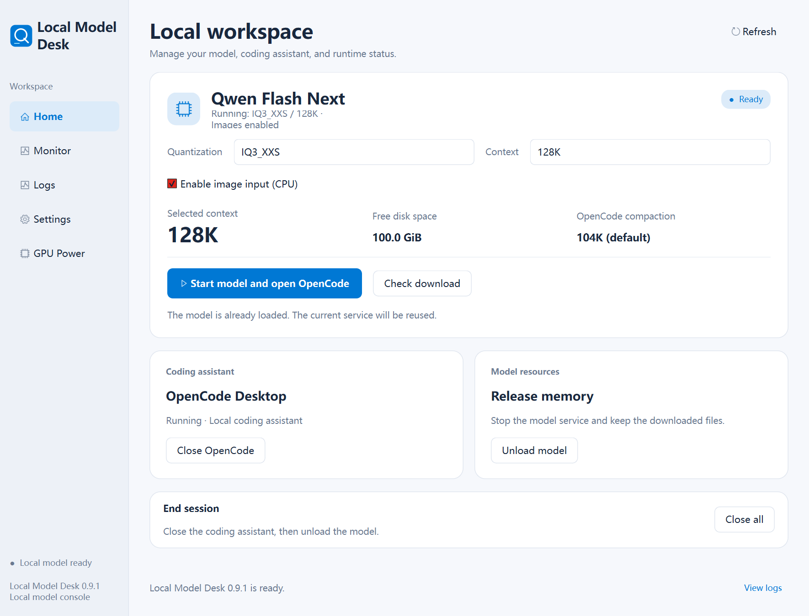
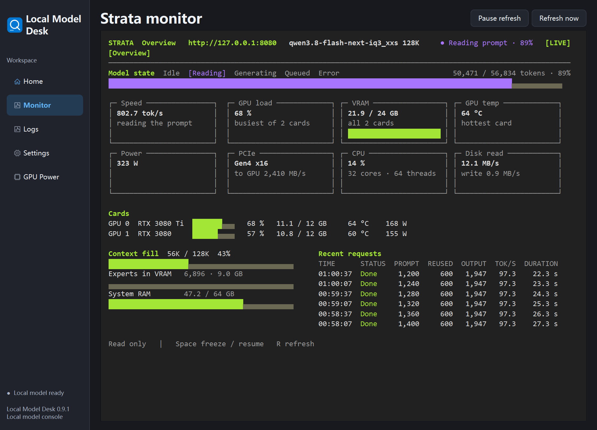
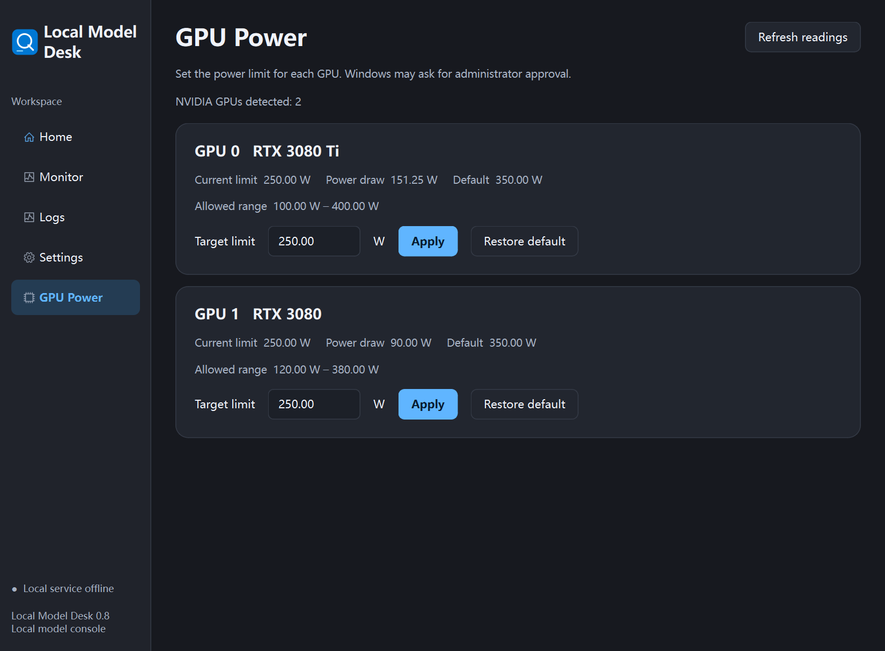
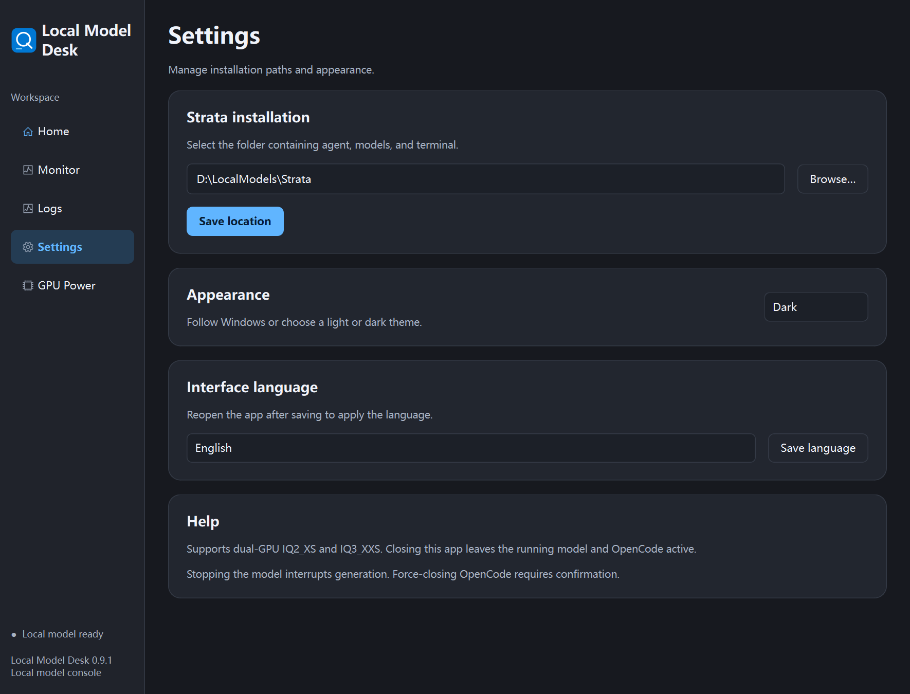

# Local Model Desk

[English documentation](../README.md) · [Windows 下载](https://github.com/uyujkk/LocalModelDesk/releases/latest) · [许可证](../LICENSE)

Local Model Desk 是 Windows 上的本地模型启动器。它管理 Strata 上的双卡 Qwen3.8-Flash-Next，打开 OpenCode，同步模型、上下文和图片输入能力。模型监控与 NVIDIA 功耗设置都在应用内完成。



*截图中的模型服务状态为模拟数据。*

## 下载与安装

1. 使用本次构建提供的 Windows x64 便携 ZIP，并核对随包的 SHA-256 文件。GitHub 的 **Source code** 是源码快照。
2. 完整解压到独立目录。打开 `LocalModelDesk.exe`，保留同目录的 `_internal`。便携包自带应用的 Python 和 Qt 运行依赖。
3. 进入 **设置 → Strata 安装位置**，选择已有部署根目录并保存。OpenCode Desktop 程序留空时自动查找已有安装。找不到或选错时，在同一页选择实际的 `OpenCode.exe`。
4. 在 **工作台** 选择量化和上下文，点 **下载预检**。确认磁盘空间和待下载量后，点 **启动模型并打开 OpenCode**。

完整便携包包含启动器、依赖、启动器源码和说明。Strata、OpenCode、NVIDIA 驱动和模型权重由各自的安装来源提供。初次部署请先安装 [Strata Terminal](https://github.com/Niko1221/Strata/blob/main/docs/INSTALL.md) 和 [OpenCode](https://opencode.ai/docs/)。目前启动器对接下面的便携部署结构。

```text
<部署根目录>/
├── terminal/0.1.57/bin/strata.cmd
├── components/
├── offline-feed/                        # 使用本地更新源时
├── models/                              # Strata 模型数据目录
└── agent/
    ├── Start-Qwen-Desktop.cmd            # OpenCode 1.x 的旧启动入口
    ├── desktop/OpenCode.exe             # OpenCode 也可以通过官方安装器装到别处
    ├── config/opencode/opencode.json    # OpenCode 1.x 的配置
    └── opencode-v2/                      # 启动 OpenCode 2 后创建
```

启动器连接本机 `http://127.0.0.1:8080`。常规升级只需退出旧版，再解压并打开新版。应用沿用 `%LOCALAPPDATA%\QwenDesk\Python\settings.json`，可在设置里保存中文、英文或跟随系统，重新打开后生效。

### 使用 OpenCode Desktop 2

OpenCode Desktop 2.2.6 及以上由 Local Model Desk 直接打开，并使用 `agent/opencode-v2/` 中单独的配置和会话数据。旧版 OpenCode 的配置和会话仍在原目录。首次启动若提示后台服务使用另一份配置，请先保存工作并结束运行中的任务，再点 **重启并继续**。

新版会加载随包提供的 `strata-charts`。在 OpenCode 的 **Settings → Extensions → Plugins** 可检查插件。可用下列提示验证图表会在回复中显示并支持切换指标。

> 用 `strata-chart` 格式画一张交互图。IQ2_XS 是 24 tok/s、15 GiB，IQ3_XXS 是 18 tok/s、19 GiB。这些是示例数据，提供解码速度和显存两个切换指标。

### 校验下载

```powershell
Get-FileHash -Algorithm SHA256 -LiteralPath '.\LocalModelDesk-v0.9.2-win-x64.zip'
```

将输出的哈希与同名的 `.sha256` 文件比对。

## 模型与上下文

- 支持双卡 Qwen3.8-Flash-Next **IQ2_XS**、**IQ3_XXS**，可选 **32K、64K、128K、256K**。启动参数用 GPU 0 作主卡、GPU 1 作辅助卡。
- **下载预检**列出配置、尚需下载的文件和内存提示。**切换模型**可能重新加载 Strata 并重开 OpenCode，请先保存进行中的工作。**卸载模型**停止服务并释放资源，模型文件留在磁盘。
- Strata 就绪后，启动器备份并更新对应的 `opencode.json`。OpenCode 的输出上限包含模型推理所用的输出 token。

| Strata 上下文 | OpenCode 输入预算 | 单次输出上限 | 默认压缩预留 | 默认压缩触发点 |
|---|---:|---:|---:|---:|
| 32K | 28K | 4K | 2K | 26K |
| 64K | 56K | 8K | 4K | 52K |
| 128K | 112K | 16K | 8K | 104K |
| 256K | 224K | 32K | 16K | 208K |

表中的 K 为 1,024 token。压缩触发点按默认预留和已启用自动压缩计算。实际稳定性与上下文填充量、硬件和其他进程有关。

## 图片输入

1. 在 **工作台** 勾选 **启用图片输入（CPU）**。首次启用的下载预检可能多出约 **0.9 GB** 的视觉编码器。
2. 启动或切换模型。Strata 报告图片已开启后，应用会同步 OpenCode 的图片附件配置。
3. 在 OpenCode 新会话里附一张截图并提问。若上传或识图有问题，先在 [Strata 网页聊天](http://127.0.0.1:8080) 用同一张图测试。

图片编码后的 token 与文本共享上下文。CPU 视觉占用系统内存，能为推理显卡保留显存。参考 [Strata 视觉文档](https://github.com/Niko1221/Strata/blob/main/docs/DETAILS.md#images-vision)。

## 监控和功耗

**监控仪表盘**在窗口内显示 Strata 运行信息。读长提示词时看读取进度，生成时看输出速率。系统内存、显存和最近请求可用于比较不同配置。

**显卡功耗**通过本机的 `nvidia-smi.exe` 读取每张 NVIDIA 显卡的功耗和可设范围。输入瓦数，点 **应用**，按 Windows 提示授权。应用会读回驱动报告的上限。**恢复默认**使用该卡的驱动默认值。系统重启或驱动重载后，先刷新确认上限是否需要重新应用。

## 常见问题

| 现象 | 检查方式 |
|---|---|
| 找不到 Strata 或 OpenCode | 在设置里选择部署根目录。核对上面的目录结构，并确认 OpenCode 启动脚本指向所列配置。 |
| 预检提示磁盘不足或内存紧张 | 查看**运行日志**里的剩余下载量。可先试较短上下文；更短上下文仍会使用同一套量化权重。 |
| 8080 已被其他服务占用 | 通过原启动方式关闭占用端口的服务，再回到工作台重试。 |
| 图片开关已选中，服务仍不接收图片 | 查看 **运行日志**和以下健康状态。若 `images` 为 `False`，检查视觉编码器及 Strata 启动日志。 |
| 功耗显示不可调 | 查看驱动是否报告最小、最大和默认上限。写入失败时核对目标值和管理员授权。 |

```powershell
Invoke-RestMethod 'http://127.0.0.1:8080/health' |
    Select-Object model, max_context, loaded, images
```

## 界面截图

### 内嵌 Strata 监控

显示提示词读取进度、最近请求和双卡运行状态。截图中的读数为模拟数据。



### 双卡功耗

每张卡分别显示当前功耗、可设上限与恢复按钮。截图中的读数为模拟数据。



### 设置

Strata 部署目录、主题和界面语言。



## 从源码运行与构建

在 Windows 11 x64 上，从仓库根目录运行。源码使用 Python 3.12。

```powershell
py -3.12 -m venv .venv
& .\.venv\Scripts\python.exe -m pip install -r .\source\requirements.txt
& .\.venv\Scripts\python.exe .\source\app.py
& .\.venv\Scripts\python.exe -m unittest discover -s .\source
& .\.venv\Scripts\python.exe .\source\app.py --smoke-test .\validation
& .\source\Build.ps1 -Python .\.venv\Scripts\python.exe
```

构建输出在 `dist/LocalModelDesk/`。界面测试使用模拟显卡写入和服务状态。提交问题时可附应用版本、Strata 版本、所选模型、上下文和相关日志，先遮盖密钥及私人路径。

应用源码采用 [MIT](../LICENSE)。内嵌监控保留 [Strata 原版权声明](../source/strata_overview/LICENSE.txt)。便携包中的第三方组件使用各自许可证，见 [第三方组件说明](../THIRD-PARTY.md)。
